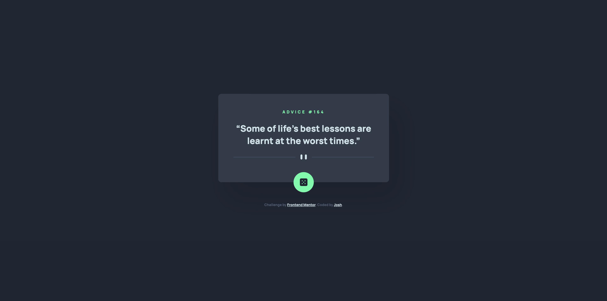

# Frontend Mentor - Advice generator app solution

This is a solution to the [Advice generator app challenge on Frontend Mentor](https://www.frontendmentor.io/challenges/advice-generator-app-QdUG-13db).

## Table of contents

- [Overview](#overview)
  - [The challenge](#the-challenge)
  - [Screenshot](#screenshot)
  - [Links](#links)
- [My process](#my-process)
  - [Built with](#built-with)
  - [What I learned](#what-i-learned)
  - [AI Collaboration](#ai-collaboration)
- [Author](#author)

## Overview

### The challenge

Users should be able to:

- View the optimal layout for the app depending on their device's screen size
- See hover states for all interactive elements on the page
- Generate a new piece of advice by clicking the dice icon

I also added:

- A loading state: the dice spins and the button is disabled while a request is in progress
- A friendly error message when the request fails, keeping the previous advice on screen
- Screen reader announcements for each new piece of advice with `aria-live`

### Screenshot



### Links

- Solution URL: [Frontend Mentor solution](https://www.frontendmentor.io/solutions/vanilla-javascript---fetch-api-with-loading-error-and-cooldown-states-jQFV6QP29D)
- Live Site URL: [advice-generator-app-one-flax.vercel.app](https://advice-generator-app-one-flax.vercel.app/)

## My process

### Built with

- Semantic HTML5 markup (`blockquote` for the advice)
- CSS custom properties
- CSS Grid
- Mobile-first workflow
- Vanilla JavaScript (`fetch`, `async` / `await`)
- [Advice Slip API](https://api.adviceslip.com)

### What I learned

**Check the real response, not just the docs.** Before writing any code, I opened the endpoint in the browser and ran it with Node (`node -e 'fetch(...).then(r => r.json()).then(console.log)'`). The real response is `{ slip: { id, advice } }`. The `id` is already a number after `res.json()`, so it can go straight into `textContent` with no conversion.

**`fetch` does not throw on HTTP errors.** A 404 or 500 still resolves successfully, so I check `res.ok` myself and throw, which sends both network errors and HTTP errors to the same `catch`:

```js
async function getAdvice(url) {
  diceBtn.disabled = true;
  try {
    const res = await fetch(url);
    if (!res.ok) throw new Error("HTTP " + res.status);
    const data = await res.json();
    adviceId.textContent = data.slip.id;
    adviceText.textContent = data.slip.advice;
    adviceError.hidden = true;
  } catch (err) {
    adviceError.textContent = "Oops! Couldn't load advice. Please try again.";
    adviceError.hidden = false;
  } finally {
    setTimeout(() => {
      diceBtn.disabled = false;
    }, COOLDOWN_MS);
  }
}
```

- **`finally` runs on success and on failure**, so the button is re-enabled in one place. If it only lived in `try`, one failed request would lock the button forever.
- **On failure the old advice stays**, and the next successful request hides the error again.

**Working with the API's cache.** The API returns the same advice for any request made within 2 seconds. Re-enabling the button right after the response (about 0.3s) meant fast clicks often showed the same advice twice. Waiting `COOLDOWN_MS` (2000ms) before re-enabling fixes that and also stops users from firing several requests at once.

**`setTimeout` and `addEventListener` both take a function, not a call.** `setTimeout(() => { diceBtn.disabled = false; }, 2000)` waits; `setTimeout(diceBtn.disabled = false, 2000)` runs the assignment immediately. The same goes for listeners: `addEventListener("click", getAdvice())` would call it once on load and register its return value instead of the function. To load advice on page load and on click, I register the listener with an arrow function and call `getAdvice(API_URL)` separately.

**Loading state with one property.** CSS spins the dice only while the button is disabled (and only if the user hasn't asked for reduced motion), so JS just toggles `diceBtn.disabled`:

```css
@media (prefers-reduced-motion: no-preference) {
  .dice-btn:disabled img { animation: spin 0.8s linear infinite; }
}
```

**A placeholder that reads as loading.** My first version showed a real advice (#117) in the HTML, which then swapped to a different one, so the page looked like it jumped twice. A neutral `Loading advice…` placeholder makes the change read as content arriving.

### AI Collaboration

I use AI as a learning partner to code better, not to skip the learning:

- Used Claude Code to write the HTML and CSS skeleton.
- Used Claude Code to explain the reasoning behind the skeleton's structure.
- Used AI to analyze the product scenario and the key points of the design.
- Wrote all of the JavaScript myself.
- Used AI to build a project notebook, where I manually fill in before, during and after notes (design analysis and planned JS flow, every blocker sorted by type, and a final review compared with similar projects) to organize my thinking, summarize the development process, and correct the mistakes I keep making.

## Author

- Website - [Josh Liu](https://my-portfolio-frontend-kappa-lemon.vercel.app/)
- Frontend Mentor - [@JoshLiu111](https://www.frontendmentor.io/profile/JoshLiu111)
